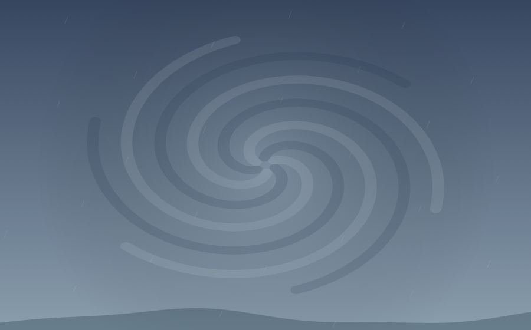

# 맘대로 — 중력 놀이터

공을 던지고, 중력을 돌리고, 블랙홀과 화이트홀 사이로 공을 순환시키는 작은 물리 놀이터입니다. macOS 앱과 웹 버전의 소스를 함께 관리합니다.

## 환경마다 다른 풍경

지구의 구름과 언덕, 달의 별과 크레이터, 해양의 빛줄기와 기포, 태풍의 회전하는 구름을 구경할 수 있습니다. 목성에는 띠와 붉은 소용돌이, 태양에는 열기와 솟아오르는 입자, 무중력에는 우주 풍경, 뒤죽박죽에는 떠다니는 기하학 무늬가 나타납니다.

| 지구 | 달 |
| --- | --- |
|  |  |
| 해양 | 태풍 |
|  |  |

배경은 Canvas로 직접 그리며 이미지 다운로드가 필요 없습니다. 바뀔 때 부드럽게 전환하고, 중력을 직접 조절해도 선택한 풍경은 유지됩니다. 모션 줄이기 설정을 사용하면 배경 애니메이션과 전환을 멈춥니다.

## 기능

- 클릭으로 공 추가, 드래그로 던지기, 잡아 끌기
- 중력 방향과 세기 **0–30g**, 탄성 **0–100%**, 흡인력 **0.2–10배**
- 블랙홀이 삼킨 공을 화이트홀에서 재방출; 여러 출구에 순서대로 분배
- 지구 · 달 · 무중력 · 목성 · 태양 · 해양 · 태풍 · 뒤죽박죽의 8개 환경
- 한 번에 공 30개 추가, 공 비, 궤적, 일시정지, 초기화
- 패널을 숨기는 감상 모드
- 공·통로·환경·풍경·설정을 한 장면으로 저장하고 복원
- 최대 공 350개, 블랙홀 6개, 화이트홀 6개

## macOS 앱 빌드

macOS 13 이상과 Swift 6이 포함된 Command Line Tools, Python 3이 필요합니다. 외부 패키지는 없습니다.

```sh
./native/scripts/build.sh
```

결과: `native/build/맘대로 중력 놀이터.app`. 원하는 응용 프로그램 폴더로 옮겨 실행할 수 있습니다. 앱은 HTML·CSS·JavaScript와 시스템 글꼴을 사용하며, 실행 시 브라우저·로컬 서버·Node.js·인터넷 연결이 필요 없습니다.

앱의 배치는 `~/Library/Application Support/com.blooossom.gravity-playground/scene.json`에 저장합니다. 브라우저에서 저장한 배치와는 별도입니다. 자세한 내용은 [앱 문서](native/README.md)를 참고하세요.

## 웹 개발 실행

```sh
python3 -m http.server 4173 --directory dist
```

<http://localhost:4173>에서 엽니다. ES 모듈을 사용하므로 파일을 직접 여는 대신 HTTP 서버로 실행하세요. 웹 버전은 Google Fonts를 읽으며, 연결이 없으면 시스템 글꼴을 사용합니다. 배치는 현재 브라우저의 localStorage에 저장합니다.

## 단축키

| 키 | 동작 |
| --- | --- |
| B | 공 던지기 도구 선택 + 공 한 개 추가 |
| G | 잡아 끌기 |
| H / W | 블랙홀 / 화이트홀 |
| F / Esc | 감상 모드 / 돌아오기 |
| Space | 일시정지 / 재생 |
| ⌘S / ⌘O | 앱에서 배치 저장 / 불러오기 |
| ⌃⌘F / ⌘Q | 앱 전체 화면 / 종료 |

## 검증

Node.js 22 이상을 사용합니다.

```sh
node --test tests/*.test.mjs
'native/build/맘대로 중력 놀이터.app/Contents/MacOS/GravityPlayground' --smoke-test
'native/build/맘대로 중력 놀이터.app/Contents/MacOS/GravityPlayground' --persistence-test
```

물리·환경·저장 테스트 17개와 실제 앱의 WebKit 실행 검사를 제공합니다. 앱 검사는 8개 배경 렌더링, 감상 모드, 통로 재방출, 네이티브 저장·복원과 별도 프로세스에서의 데이터 유지 여부를 확인합니다. 테스트 데이터는 사용자 배치와 다른 폴더에 저장됩니다.

## 구성

- `dist/physics.mjs`: 고정 시간 간격과 공간 격자 기반 물리 시뮬레이션
- `dist/environments.mjs`: 환경별 중력·저항·회전력 설정
- `dist/backdrops.mjs`: 캐시된 풍경과 가벼운 애니메이션
- `dist/scene.mjs`, `dist/storage.mjs`: 저장 데이터 검증 및 저장 경로 연결
- `dist/app.js`, `dist/index.html`, `dist/style.css`: 조작·렌더링·화면
- `native/`: macOS 창, 저장 기능, 번들 생성과 아이콘
- `tests/`: 물리·환경·저장 회귀 검사

재미를 위한 근사 시뮬레이션이며 실제 천체·유체의 모든 특성을 재현하지 않습니다. 천체 중력값 참고: [NASA 행성 자료](https://nssdc.gsfc.nasa.gov/planetary/factsheet/), [NASA 태양 자료](https://nssdc.gsfc.nasa.gov/planetary/factsheet/sunfact.html).
